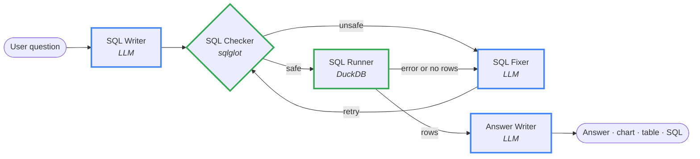
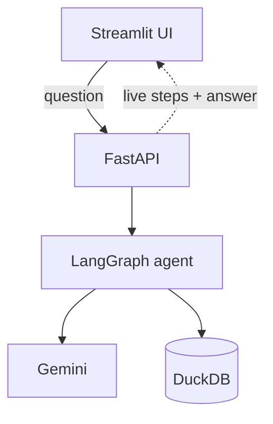

# Data Analyst Agent

**Ask a business question in plain English. Get back the answer, a chart, the data, and the SQL that produced it.**

A self-correcting, multi-step AI agent built with **LangGraph**. It writes SQL, checks it is safe, runs it, and when the query fails it reads the error and fixes its own SQL before answering. Every step streams live to the UI, so you can watch the agent think.


## Demo

> **Video walkthrough:** _add your video link here_

<!-- Optional: add a screenshot or GIF at docs/demo.gif and uncomment the next line -->
<!--  -->

**Example:** *"Top 5 product categories by revenue in 2018"*

```
✓ SQL query generated
✓ Safety check passed
✓ Results fetched (5 rows)
✓ Analysing results...
→ Answer + bar chart + table + the SQL used
```

When something goes wrong, you see the agent recover:

```
gemini-3.8-flash failed (server busy), retrying with gemini-3.5-flash-lite
SQL query generated
Safety check passed
Query failed: Binder Error: Referenced column "customer_stat" not found
Fixing the query (try 2)...
Safety check passed
Results fetched (10 rows)
Analysing results...
```

## Key features

- **Self-correcting SQL loop.** Database errors and empty results are fed back to a fixer agent, which rewrites the query. It retries up to 3 times, then gives an honest *"I couldn't answer"* instead of guessing.
- **Safety guard before every query.** SQL is parsed with [sqlglot](https://github.com/tobymao/sqlglot), not matched with regex. Only a single `SELECT` is allowed; `DELETE`, `DROP`, `ATTACH`, `COPY`, multiple statements and file-reading functions are blocked. The database is also opened **read-only**, so there are two layers of protection.
- **Grounded in business rules.** A plain-English notes file (`app/db/olist_notes.md`) tells the LLM how tables join and how metrics are defined (for example *revenue excludes freight and cancelled orders*). This prevents classic mistakes like double-counting revenue across one-to-many joins.
- **Structured LLM outputs.** Every LLM call returns a validated Pydantic object (the SQL, or the answer plus chart choice), not free text that has to be parsed.
- **Live progress streaming.** Each step reports what it's doing through LangGraph's stream writer. The API streams these as NDJSON and the UI shows them live.
- **Model fallback.** If the main Gemini model is overloaded or rate-limited, the agent tells the user and retries on a backup model. It doesn't fall back on errors like a bad API key.
- **Transparent answers.** Every answer shows the SQL used and every failed attempt, so a user can verify the result.

## Architecture

### The agent (LangGraph)



**Blue** = LLM agent, **green** = plain code (no LLM). After 3 failed attempts the graph routes straight to the Answer Writer, which returns an honest failure message.

| Step | Type | What it does |
| --- | --- | --- |
| **SQL Writer** | LLM agent | Turns the question + schema + business notes into a DuckDB query |
| **SQL Checker** | Guardrail (no LLM) | Parses the SQL and rejects anything that isn't a single safe `SELECT` |
| **SQL Runner** | Tool (no LLM) | Runs the query read-only, caps rows, and flags errors or empty results |
| **SQL Fixer** | LLM agent | Rewrites the query using the exact error message |
| **Answer Writer** | LLM agent | Writes a 2–4 sentence answer using only numbers from the result, and picks a chart |

### The system



The UI sends the question to `POST /ask/stream` and receives live progress lines (NDJSON) followed by the final answer. The agent calls Gemini (with an automatic fallback model) and queries DuckDB in read-only mode. The UI never imports agent code, so the frontend and backend can be deployed separately.

## Tech stack

| Layer | Tool | Why |
| --- | --- | --- |
| Agent orchestration | LangGraph | Explicit graph with conditional retry edges; built-in streaming |
| LLM | Google Gemini (via LangChain) | Free tier, structured output support |
| SQL safety | sqlglot | Real SQL parser, so it inspects the query's structure rather than its text |
| Database | DuckDB | Fast analytical SQL on a single file; no server to run |
| Backend | FastAPI | Typed request/response models, streaming responses, auto-generated docs |
| Frontend | Streamlit | Chat UI, charts and tables in pure Python |
| Config | pydantic-settings | All settings in one place, loaded from `.env` |

## Dataset

[Brazilian E-Commerce Public Dataset by Olist](https://www.kaggle.com/datasets/olistbr/brazilian-ecommerce): about 100k real orders from 2016–2018 across 9 related tables (orders, items, customers, sellers, products, payments, reviews, geolocation, category translations).

## Try these questions

- Top 5 product categories by revenue in 2018
- How many orders were placed each month in 2017?
- Which 10 states have the most customers?
- What is the average review score by product category? Show the lowest 10.
- What share of payments use each payment type?

## Project structure

```
app/
├── agent/
│   ├── state.py            # shared state passed between steps
│   ├── sql_writer.py       # Agent 1: question -> SQL
│   ├── sql_checker.py      # Guardrail: SQL safety check
│   ├── sql_runner.py       # Runs SQL on DuckDB
│   ├── sql_fixer.py        # Agent 2: repairs failed SQL
│   ├── answer_writer.py    # Agent 3: answer + chart choice
│   └── graph.py            # LangGraph wiring, retry loop, streaming
├── api/main.py             # FastAPI: /health, /ask, /ask/stream
├── db/
│   ├── database.py         # read-only queries + schema description
│   └── olist_notes.md      # business rules given to the LLM
├── llm.py                  # Gemini client + fallback model
├── progress.py             # live progress messages
└── config.py               # settings from .env
ui/streamlit_app.py         # chat UI
scripts/build_olist_db.py   # loads the CSVs into DuckDB
```

Each file has one job and a docstring; most are under 100 lines.

## Getting started

**Requirements:** Python 3.11+ and a free [Gemini API key](https://aistudio.google.com/apikey).

```bash
# 1. Install
git clone <your-repo-url>
cd Data_Analyst_Agent
python -m venv .venv && source .venv/bin/activate
pip install -r requirements.txt

# 2. Configure
cp .env.example .env          # then paste your key after GOOGLE_API_KEY=

# 3. Get the data
#    Download the dataset from Kaggle (link above) and put the 9 CSVs in data/raw/
python scripts/build_olist_db.py

# 4. Run (two terminals)
uvicorn app.api.main:app --reload       # API  -> http://localhost:8000/docs
streamlit run ui/streamlit_app.py       # UI   -> http://localhost:8501
```

## API

| Endpoint | Description |
| --- | --- |
| `GET /health` | Returns `{"status": "ok"}` |
| `POST /ask` | `{"question": "..."}` → answer, SQL, columns, rows, chart, failed attempts |
| `POST /ask/stream` | Same input, but streams one JSON object per line while the agent works |

Example stream:

```json
{"type": "step", "message": "SQL query generated"}
{"type": "step", "message": "Safety check passed"}
{"type": "step", "message": "Results fetched (5 rows)"}
{"type": "step", "message": "Analysing results..."}
{"type": "result", "data": {"answer": "...", "sql": "...", "columns": [], "rows": [], "chart": {}}}
```

## Design decisions

- **Separate agents instead of one big prompt.** Writing, fixing and explaining are different tasks with different inputs. Separate prompts are easier to test, debug and improve one at a time.
- **Guardrail and tools without an LLM.** Safety checks and query execution are deterministic code. The LLM is only used where judgment is needed.
- **Empty results count as a failure, once.** An empty result usually means a wrong filter (for example `'Canceled'` vs `'canceled'`), so the fixer gets one chance to check. If it returns the same SQL, the empty result is accepted as correct.
- **Business rules in a notes file, not in code.** Most wrong answers from text-to-SQL come from misunderstood metrics, not bad syntax. Keeping definitions in one readable file makes them easy to review and change without touching code.
- **Fallback only on errors another model can fix.** Server overload, rate limits and an unknown model trigger the backup; a wrong API key fails loudly.

## Limitations and next steps

- **No evaluation suite yet.** Next: a set of questions with verified answers, scoring execution accuracy.
- **No tracing yet.** Next: Langfuse traces for every run (latency, tokens, each step's input and output).
- **No conversation memory.** Each question is answered on its own; follow-ups like *"now split by state"* are not supported yet.
- **A query can run and still be logically wrong.** The notes file reduces this, and showing the SQL lets users check, but an eval suite is the real fix.
- **Free-tier limits.** Gemini's free tier can be slow or busy at peak times; the fallback model helps but doesn't remove this.
- **Local only.** 